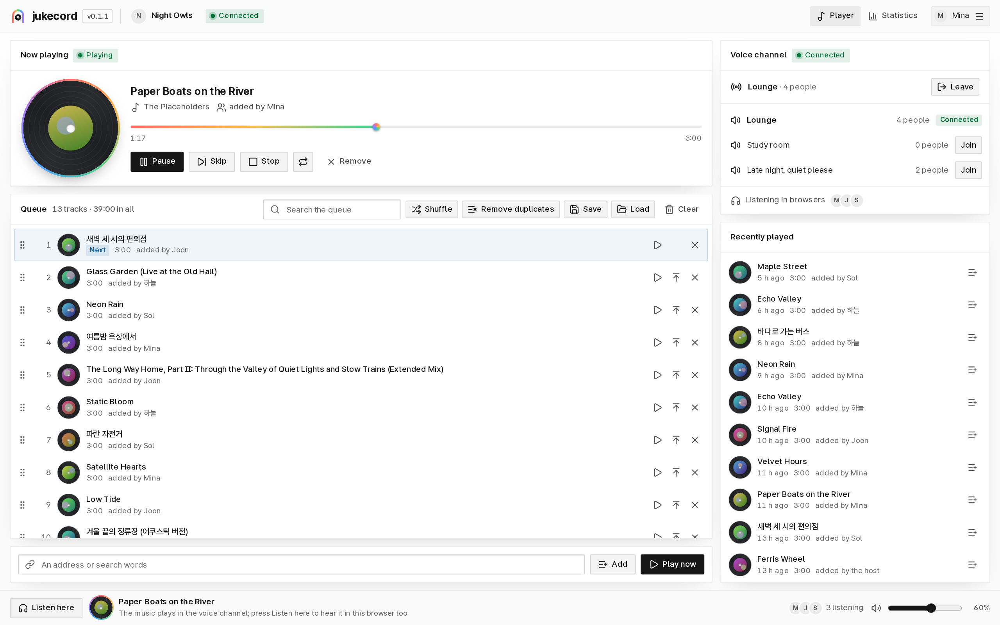

<p align="center">
  <picture>
    <source media="(prefers-color-scheme: dark)" srcset="docs/assets/logo-dark.svg">
    
  </picture>
</p>

<p align="center">
  <b>A self-hosted Discord music bot whose queue you also hear in the browser.</b><br>
  Friends in the voice channel and friends with only a browser tab hear the same song at the same second.
</p>

<p align="center">
  <a href="https://github.com/kanggu12/jukecord/actions/workflows/ci.yml"></a>
  <a href="https://github.com/kanggu12/jukecord/releases"></a>
  <a href="LICENSE"></a>
  
</p>

<p align="center">
  <a href="#quick-start">Quick start</a> |
  <a href="docs/README.md">User guide</a> |
  <a href="docs/INSTALL.md">Install</a> |
  <a href="docs/KUBERNETES.md">Kubernetes</a> |
  <a href="docs/API.md">API</a> |
  <a href="docs/ARCHITECTURE.md">Architecture</a> |
  <a href="CONTRIBUTING.md">Contributing</a>
</p>

<p align="center">
  <picture>
    <source media="(prefers-color-scheme: dark)" srcset="docs/assets/panel-dark.png">
    
  </picture>
</p>

jukecord plays music from YouTube, SoundCloud and the other sites [yt-dlp](https://github.com/yt-dlp/yt-dlp) reads, in
a Discord voice channel. Its web panel shows the same queue, and anyone logged in can press **Listen here** to hear it
in the browser, in time with the voice channel. Everything the panel does is also a slash command, an HTTP API call and
a `jukecord` command.

- One queue per Discord server: add by address or search words, play now, skip, seek, repeat, reorder by dragging,
  shuffle, remove duplicates, save and load playlists, play again from the history.
- Listening statistics: plays per day and hour, the most played tracks, who added most.
- Logging in with Discord (or one-time links from the machine it runs on), a DJ role per server, API tokens.
- Runs on your own machine with Docker Compose, on a Raspberry Pi 4 or 5, or on Kubernetes with the Helm chart, on amd64 and
  arm64. Without a bot token it runs browser-only.

## Quick start

**Docker Compose** on Linux, macOS or WSL. It builds the image, starts jukecord on this machine, and prints a login link:

```bash
git clone https://github.com/kanggu12/jukecord.git && cd jukecord
./jukecord up
./jukecord open
```

Then make the Discord bot (once, below) and give jukecord its token. Until then jukecord plays in the browser only.

```bash
echo 'JUKECORD_DISCORD_TOKEN=YOUR_BOT_TOKEN' >> .env
./jukecord up
```

**Kubernetes** with Helm (the token in a Secret of your own):

```bash
kubectl create namespace jukecord
kubectl -n jukecord create secret generic jukecord-discord --from-literal=token=YOUR_BOT_TOKEN
helm install jukecord oci://ghcr.io/kanggu12/charts/jukecord -n jukecord --set discord.existingSecret=jukecord-discord --wait
kubectl -n jukecord port-forward svc/jukecord 8795:8795 &
kubectl -n jukecord exec deploy/jukecord -- jukecord link
```

**From source** with Node 24.11 or newer, ffmpeg and yt-dlp installed:

```bash
npm ci && npm run build
JUKECORD_DISCORD_TOKEN=YOUR_BOT_TOKEN npm start
```

Then, in another terminal, a login link: `node src/cli/main.ts link`.

[Install](docs/INSTALL.md) has the details: a public address for friends, logging in with Discord, a reverse proxy,
starting at boot, updates and backups.

## The Discord bot

1. On the [Discord Developer Portal](https://discord.com/developers/applications), make an application, open **Bot**,
   and press **Reset Token**. That token is `JUKECORD_DISCORD_TOKEN`. jukecord needs none of the privileged intents.
2. Open **OAuth2**, tick the scopes `bot` and `applications.commands`, and the bot permissions **View Channels**,
   **Connect** and **Speak**. Open the link it makes and add the bot to your server.
3. For logging in to the panel with Discord: copy the **Client ID** and **Client Secret** from **OAuth2** into
   `JUKECORD_DISCORD_CLIENT_ID` and `JUKECORD_DISCORD_CLIENT_SECRET`, and add `<your panel's address>/auth/callback`
   to **Redirects**.

Slash commands appear in the server within seconds of the bot joining. `/play`, `/add`, `/queue`, `/np` and `/listen`
are the ones people use most; the [user guide](docs/README.md) lists them all.

## What it runs on

| Where                            | How                                                             |
| :------------------------------- | :-------------------------------------------------------------- |
| Linux, macOS, Windows (WSL)      | Docker Compose: `./jukecord up`                                 |
| Raspberry Pi 4 or 5, ARM servers | the same, on a 64-bit OS (the image is built for arm64)         |
| Kubernetes, k3s                  | the Helm chart: NetworkPolicy, probes, a non-root read-only pod |
| Anywhere with Node 24.11+        | from source, with ffmpeg (with libopus) and yt-dlp              |

## License

[MIT](LICENSE). The image carries FFmpeg, yt-dlp and other parts under their own licences:
[third-party notices](docs/THIRD_PARTY_NOTICES.md).
