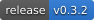
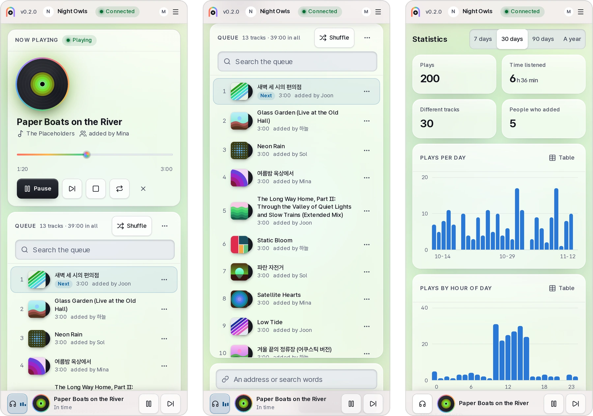

<p align="center">
  <picture>
    <source media="(prefers-color-scheme: dark)" srcset="docs/assets/logo-dark.svg">
    
  </picture>
</p>

<p align="center">
  <b>A self-hosted Discord music bot whose queue you also hear in the browser.</b><br>
  Friends in the voice channel and friends with only a browser tab hear the same song at the same second.
</p>

<p align="center">
  <a href="https://github.com/kanggu12/jukecord/actions/workflows/ci.yml"></a>
  <a href="https://github.com/kanggu12/jukecord/releases"></a>
  <a href="LICENSE"></a>
  
</p>

<p align="center">
  <a href="#quick-start">Quick start</a> &nbsp;|&nbsp;
  <a href="#features">Features</a> &nbsp;|&nbsp;
  <a href="#how-it-works">How it works</a> &nbsp;|&nbsp;
  <a href="#guides">Guides</a> &nbsp;|&nbsp;
  <a href="#open-source">Open source</a>
</p>

<p align="center">
  <picture>
    <source media="(prefers-color-scheme: dark)" srcset="docs/assets/panel-dark.webp">
    
  </picture>
</p>

jukecord plays music from YouTube, SoundCloud and the other sites [yt-dlp](https://github.com/yt-dlp/yt-dlp) reads,
in a Discord voice channel. Its web panel shows the same queue, and anyone logged in can press **Listen here** to hear
it in the browser at the same place in the track: a friend at work, on a phone, or anywhere Discord's voice is not at
hand. It runs on your own computer, a Raspberry Pi or a Kubernetes cluster, and keeps everything there.

## Quick start

**Docker Compose** on Linux, macOS or Windows (WSL). It builds the image, starts jukecord, and opens the panel with a
one-time login link:

```bash
git clone https://github.com/kanggu12/jukecord.git && cd jukecord
./jukecord up
./jukecord open
```

Without a bot token jukecord plays in the browser only. [Make the bot](#the-discord-bot), then give it the token:

```bash
echo 'JUKECORD_DISCORD_TOKEN=YOUR_BOT_TOKEN' >> .env
./jukecord up
```

**Kubernetes** with the Helm chart, the token in a Secret of your own:

```bash
kubectl create namespace jukecord
kubectl -n jukecord create secret generic jukecord-discord --from-literal=token=YOUR_BOT_TOKEN
helm install jukecord oci://ghcr.io/kanggu12/charts/jukecord -n jukecord --set discord.existingSecret=jukecord-discord --wait
kubectl -n jukecord port-forward svc/jukecord 8795:8795 &
kubectl -n jukecord exec deploy/jukecord -- jukecord link
```

**From source**, with Node 24.11 or newer, ffmpeg and yt-dlp installed:

```bash
git clone https://github.com/kanggu12/jukecord.git && cd jukecord
npm ci && npm run build
JUKECORD_DISCORD_TOKEN=YOUR_BOT_TOKEN npm start
```

In another terminal, `node src/cli/main.ts link` prints a login link.

[Installing, step by step](docs/INSTALL.md) has a public address for friends, logging in with Discord, starting with
the machine, updates and backups; [without internet](docs/OFFLINE.md) moves the image to a machine that cannot reach
the registries.

### The Discord bot

1. On the [Discord Developer Portal](https://discord.com/developers/applications), make an application, open **Bot**
   and press **Reset Token**. That token is `JUKECORD_DISCORD_TOKEN`. jukecord needs none of the privileged intents.
2. Open **OAuth2**, tick the scopes `bot` and `applications.commands` and the bot permissions **View Channels**,
   **Connect** and **Speak**, then open the link it makes and add the bot to your server.
3. For logging in to the panel with Discord, copy the **Client ID** and **Client Secret** from **OAuth2** into
   `JUKECORD_DISCORD_CLIENT_ID` and `JUKECORD_DISCORD_CLIENT_SECRET`, and add `<your panel's address>/auth/callback`
   to **Redirects**. Without them only the host logs in, with `./jukecord open`.

The slash commands appear in the server within seconds. `/play`, `/add`, `/np`, `/queue` and `/listen` are the ones
people use most.

### What it runs on

|                    | Needs                                                                                                                                                                                                                                                                                                                                                                                                    |
| :----------------- | :------------------------------------------------------------------------------------------------------------------------------------------------------------------------------------------------------------------------------------------------------------------------------------------------------------------------------------------------------------------------------------------------------- |
| **Docker Compose** | Linux, macOS, or Windows with WSL, on amd64 or arm64, with Docker and Compose 2.24 or newer; about 430 MB for the image and 2 GiB for the cache (its default limit). The first `./jukecord up` builds the image, FFmpeg included: about a minute on a fast desktop, much longer on a Raspberry Pi, where a released image skips it ([installing](docs/INSTALL.md#raspberry-pi-and-other-arm64-machines)) |
| **Raspberry Pi**   | A Pi 4 or 5 with a 64-bit system, through Docker Compose                                                                                                                                                                                                                                                                                                                                                 |
| **Kubernetes**     | The Helm chart on amd64 or arm64 nodes, k3s included, with a 5 GiB volume (its default)                                                                                                                                                                                                                                                                                                                  |
| **From source**    | Node 24.11 or newer, ffmpeg with libopus, and yt-dlp                                                                                                                                                                                                                                                                                                                                                     |
| **Listening**      | A current browser on a computer or a phone; Safari gets an MP3 copy of each track                                                                                                                                                                                                                                                                                                                        |

## Features

- **Listen along.** The **Listen here** key plays the queue in the browser, at the browser's own volume, in step with
  the voice channel: a browser more than 0.3 s off the player's clock jumps back in line. The media keys and the lock screen of a
  computer or a phone control it.
- **One queue per server.** Add by address or search words (a playlist page adds its tracks), play now or next,
  reorder by dragging, shuffle, remove duplicates, repeat a track or the queue, save and load playlists, play again
  from the history.
- **Four ways in.** The panel, slash commands in English and Korean, the `jukecord` command and an HTTP API do the same
  things under the same rules; [the API](docs/API.md) lists each operation beside its command and slash command.
- **Logins and roles.** People log in with Discord and see the servers they share with the bot. A DJ role, when a
  server sets one, decides who may change the music. API tokens for scripts, one-time links for the host.
- **Even loudness.** Each track is fetched once, its loudness evened out, and kept as Opus in a cache with a size
  limit. The next tracks are fetched while one plays.
- **Statistics.** Plays per day and per hour, the most played tracks and who added most, over a week up to a year.
- **A panel lit by the music.** Frosted glass over the colours of the cover that is playing, in light and dark, in
  English and Korean, on a phone as on a desk. Everything works from the keyboard, and motion and transparency follow
  the system's settings.
- **Steady in a crowd.** A change is made into one message and compressed once for every panel that shows it. Changes
  are held to a rate per login, a jukecord that falls behind answers "busy" instead of slowing for everyone, and one
  that hangs ends itself and comes back paused where it was.
- **Small and contained.** One process and one SQLite file. It fetches only from public addresses, keeps its files to
  its own user, and on Kubernetes runs as a read-only, non-root pod behind a NetworkPolicy.

### Light on a small machine

On two processor cores, with a year of use in it (a thousand tracks queued, 10,000 plays), jukecord rests at about
80 MB of memory, answers every read the panel makes in about 20 ms or less, and has a four-minute track ready in
about 3.5 s. A thousand panels open at once see each change of that queue within about a tenth of a second, and cost
the server 112 MiB and under three quarters of one core while it changes three times a second
([how it was measured](docs/TESTING.md#measurements)).

<p align="center">
  <picture>
    <source media="(prefers-color-scheme: dark)" srcset="docs/assets/phones-dark.webp">
    
  </picture>
</p>

## How it works

<p align="center">
  <picture>
    <source media="(prefers-color-scheme: dark)" srcset="docs/assets/how-it-works-dark.svg">
    
  </picture>
</p>

Each Discord server has one queue and one player, and the player is the clock: it knows the track and the place in it.
The bot sends the voice channel the track from that place, and a browser that listens plays the same file and follows
the same clock. yt-dlp fetches the tracks, and every connection it makes goes through a proxy inside jukecord that
reaches only public addresses. ffmpeg evens out the loudness once and keeps the track as Opus, which goes to Discord as
it is. Discord, the panel, the API and the command all call one list of actions, so the same rules hold whichever is
used ([architecture](docs/ARCHITECTURE.md), [decisions](docs/DECISIONS.md)).

## Everyday use

| To                   | With Docker Compose                                              |
| :------------------- | :--------------------------------------------------------------- |
| Open the panel       | `./jukecord open`                                                |
| See how it runs      | `./jukecord status`, and `./jukecord doctor` to check every part |
| Read the log         | `./jukecord logs`, or the **Log** page in the panel              |
| Back up the database | `./jukecord backup`, into `./backups`                            |
| Update               | `git pull && ./jukecord update`                                  |
| Stop                 | `./jukecord down`; the data stays                                |

Anything else goes to the `jukecord` command inside: `./jukecord np`, `./jukecord add <address or words>`,
`./jukecord token create <name>`. On Kubernetes the same command runs through `kubectl exec`
([Kubernetes](docs/KUBERNETES.md)).

## Your data

The queues, the history, the playlists, the settings and the logins are in one SQLite file in jukecord's data folder,
and the fetched tracks beside it, up to `JUKECORD_CACHE_MAX`. Logins and tokens are kept only as hashes, and the logs
mask tokens. jukecord itself talks to Discord and to the sites the tracks come from, and sends no telemetry; the panel
shows the tracks' pictures from those sites and people's pictures from Discord. Docker Compose publishes the panel on
this computer only, until you give it a [public address](docs/INSTALL.md#friends-on-other-machines).

## Guides

| Guide                                                                                              | What it covers                                                                                                     |
| :------------------------------------------------------------------------------------------------- | :----------------------------------------------------------------------------------------------------------------- |
| [Using jukecord](docs/README.md)                                                                   | The panel, the slash commands, the `jukecord` command, who may do what, the settings                               |
| [Questions and answers](docs/FAQ.md)                                                               | What it takes to run, listening with friends, what leaves your computer                                            |
| [Installing](docs/INSTALL.md)                                                                      | Docker Compose, friends on other machines, logging in with Discord, Raspberry Pi, from source, updates and backups |
| [Kubernetes](docs/KUBERNETES.md)                                                                   | The Helm chart: its values, the Ingress, the NetworkPolicy, k3s                                                    |
| [Without internet](docs/OFFLINE.md)                                                                | Building the image, moving it and the data to a machine without internet access                                    |
| [The API](docs/API.md)                                                                             | Every operation over HTTP, beside its command and slash command, and the live updates                              |
| [Troubleshooting](docs/TROUBLESHOOTING.md)                                                         | YouTube's bot check, a silent bot or browser, logins, a port in use                                                |
| [Architecture](docs/ARCHITECTURE.md) · [Decisions](docs/DECISIONS.md) · [Testing](docs/TESTING.md) | How it is built, why, and how it is checked                                                                        |

## Open source

jukecord is MIT licensed and built in the open. Its tests need no Discord bot: yt-dlp and Discord have stand-ins, and
the panel is checked against a seeded server.

- **Report a bug or ask for a feature** in [Issues](https://github.com/kanggu12/jukecord/issues/new/choose).
- **Change the code.** [CONTRIBUTING.md](CONTRIBUTING.md) has the setup and a map of the code:

  ```bash
  npm ci
  npm run check                        # lint, types and the tests
  tests/ui/run.sh /tmp/jukecord-look   # the panel at eight widths, in both themes and languages
  ```

- **See what changed** in [CHANGELOG.md](CHANGELOG.md), and report a security problem through
  [SECURITY.md](.github/SECURITY.md).

## License

[MIT](LICENSE). The image carries FFmpeg, yt-dlp and other parts under their own licences:
[third-party notices](docs/THIRD_PARTY_NOTICES.md).
