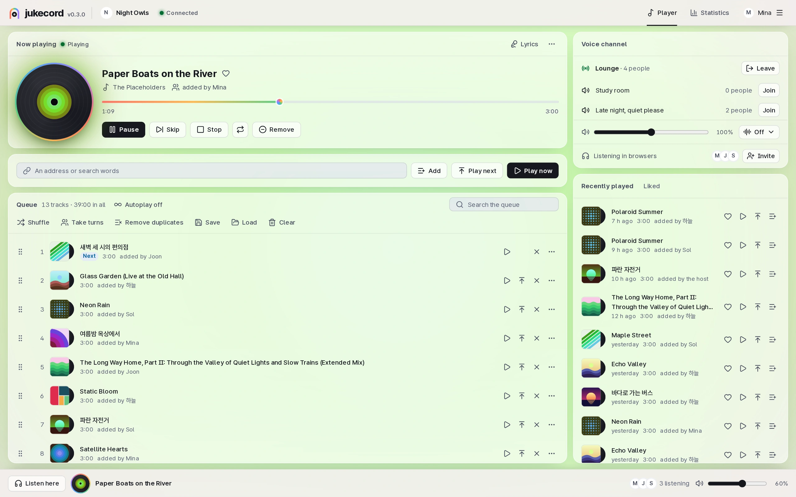
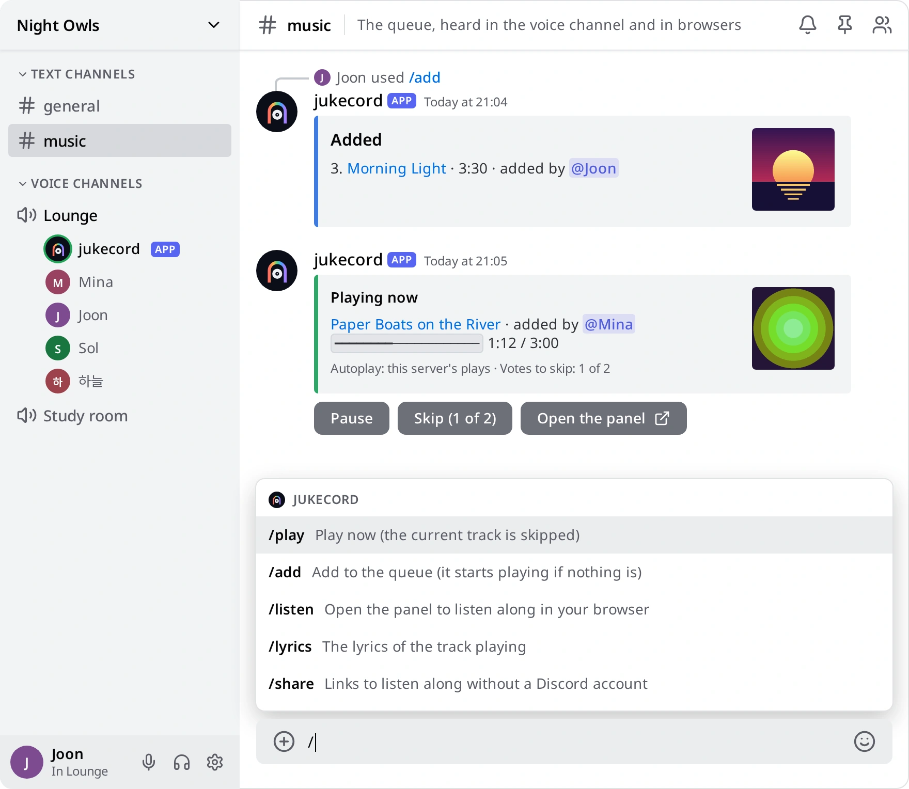
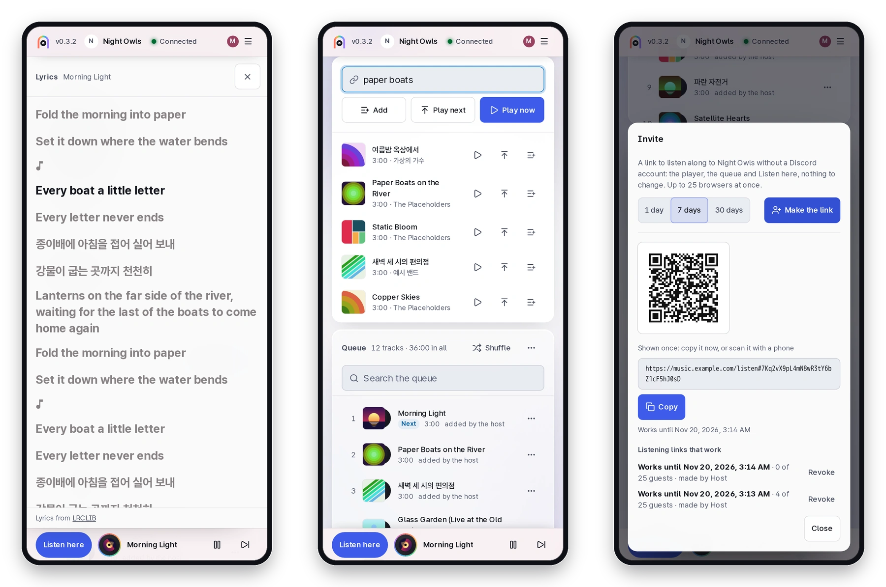

<p align="center">
  <picture>
    <source media="(prefers-color-scheme: dark)" srcset="docs/assets/logo-dark.svg">
    
  </picture>
</p>

<p align="center">
  <b>A self-hosted Discord music bot whose queue you also hear in the browser.</b><br>
  Friends in the voice channel and friends with only a browser tab hear the same song at the same second.
</p>

<p align="center">
  <a href="https://github.com/kanggu12/jukecord/actions/workflows/ci.yml"></a>
  <a href="https://github.com/kanggu12/jukecord/releases"></a>
  <a href="LICENSE"></a>
  
</p>

<p align="center">
  <a href="#quick-start">Quick start</a> &nbsp;|&nbsp;
  <a href="#what-it-does">What it does</a> &nbsp;|&nbsp;
  <a href="#how-it-works">How it works</a> &nbsp;|&nbsp;
  <a href="#guides">Guides</a>
</p>

<p align="center">
  <picture>
    <source media="(prefers-color-scheme: dark)" srcset="docs/assets/panel-dark.webp">
    
  </picture>
</p>

jukecord plays music from YouTube, SoundCloud and the other sites [yt-dlp](https://github.com/yt-dlp/yt-dlp) reads in
a Discord voice channel. Its web panel shows the same queue, and **Listen here** plays it in any browser at the same
place in the track. It runs on your own computer, a Raspberry Pi or a Kubernetes cluster.

## Quick start

<table>
<tr>
<th width="50%" align="left">Listen</th>
<th width="50%" align="left">Host</th>
</tr>
<tr>
<td valign="top">

On a jukecord someone runs for your server:

1. Open the address the host gives you and log in with Discord, or open a listening link: it needs no account.
2. Press **Listen here**. The queue plays in your browser, in step with the voice channel, at your own volume.
3. Add music in the panel or with `/play` in Discord.

**[Using jukecord](docs/README.md)**

</td>
<td valign="top">

On a computer that stays on while people listen:

1. Start it with the commands below for your system.
2. [Make the Discord bot](#the-discord-bot) and give jukecord its token, or skip it to play in browsers only.
3. `./jukecord open` logs you in; **Invite** in the panel makes links for friends.

**[Installing](docs/INSTALL.md)**

</td>
</tr>
</table>

**Docker Compose** on Linux, macOS or Windows (WSL):

```bash
git clone https://github.com/kanggu12/jukecord.git && cd jukecord
./jukecord up
./jukecord open
```

With the bot's token:

```bash
echo 'JUKECORD_DISCORD_TOKEN=YOUR_BOT_TOKEN' >> .env
./jukecord up
```

**Kubernetes:** the Helm chart from `oci://ghcr.io/kanggu12/charts/jukecord`, the token in a Secret of your own:
[install on a cluster](docs/KUBERNETES.md#install).

**From source**, with Node 24.11 or newer, ffmpeg and yt-dlp installed (`node src/cli/main.ts link` then prints a
login link):

```bash
git clone https://github.com/kanggu12/jukecord.git && cd jukecord
npm ci && npm run build
JUKECORD_DISCORD_TOKEN=YOUR_BOT_TOKEN npm start
```

### The Discord bot

1. On the [Discord Developer Portal](https://discord.com/developers/applications), make an application, open **Bot**
   and press **Reset Token**. That token is `JUKECORD_DISCORD_TOKEN`.
2. Open **OAuth2**, tick the scopes `bot` and `applications.commands` and the permissions **View Channels**, **Connect**
   and **Speak**, then open the link it makes to add the bot to your server.
3. For logging in with Discord, put the **Client ID** and **Client Secret** in `JUKECORD_DISCORD_CLIENT_ID` and
   `JUKECORD_DISCORD_CLIENT_SECRET`, and add `<your panel's address>/auth/callback` to **Redirects**.

## What it does

### In Discord

Slash commands in English and Korean, with Discord suggesting tracks as you type. The bot says what it added, and
keeps one card of the track playing up to date, with keys to pause, skip (a vote, where a DJ role is set) and open
the panel.

<p align="center">
  <picture>
    <source media="(prefers-color-scheme: dark)" srcset="docs/assets/discord-dark.webp">
    
  </picture>
</p>

### In any browser, in step

**Listen here** plays the queue in the browser in step with the voice channel, for a friend at work or on a phone. The
lyrics follow the line being sung, a search shows what YouTube found as you type, and a listening link with its QR code
lets anyone without a Discord account listen along.

<p align="center">
  <picture>
    <source media="(prefers-color-scheme: dark)" srcset="docs/assets/phones-features-dark.webp">
    
  </picture>
</p>

### And the rest

- **One queue, four ways in:** the panel, slash commands, the `jukecord` command and an [HTTP API](docs/API.md), under
  the same rules; a DJ role decides who may change the music.
- **Fair in a crowd:** votes to skip, people taking turns, a limit per person, and a voice channel's volume and sounds
  that browsers hear too.
- **Autoplay, likes and playlists** as files, and links from Deezer, Spotify and Apple Music.
- **Wrapped:** a server's year in music, saved as a picture for a story or a post.
- **Steady and small:** one process and one SQLite file, tracks fetched once with their loudness evened out.

<p align="center">
  <picture>
    <source media="(prefers-color-scheme: dark)" srcset="docs/assets/wrapped-dark.webp">
    
  </picture>
</p>

## How it works

<p align="center">
  <picture>
    <source media="(prefers-color-scheme: dark)" srcset="docs/assets/how-it-works-dark.svg">
    
  </picture>
</p>

Each Discord server has one queue and one player, and the player is the clock that the voice channel and every browser
follow ([architecture](docs/ARCHITECTURE.md)). On two cores with a year of use in it, jukecord rests at about 85 MiB
of memory, and a thousand open panels see each change within about a tenth of a second
([measured](docs/TESTING.md#measurements)).

### Your data

Everything stays in jukecord's data folder: one SQLite file and the tracks it fetched. Logins and tokens are kept as
hashes, and nothing is sent as telemetry. jukecord talks to Discord, to the sites the tracks come from and, for lyrics,
to LRCLIB ([what leaves your computer](docs/FAQ.md#privacy)).

## What it runs on

|                    | Needs                                                                                                                                   |
| :----------------- | :-------------------------------------------------------------------------------------------------------------------------------------- |
| **Docker Compose** | Linux, macOS or Windows (WSL), amd64 or arm64, Docker with Compose 2.24 or newer; 430 MB for the image, 2 GiB for the cache             |
| **Raspberry Pi**   | A Pi 4 or 5 with a 64-bit system, through Docker Compose with a [released image](docs/INSTALL.md#raspberry-pi-and-other-arm64-machines) |
| **Kubernetes**     | The Helm chart on amd64 or arm64 nodes, k3s included, with a 5 GiB volume                                                               |
| **From source**    | Node 24.11 or newer, ffmpeg with libopus, and yt-dlp                                                                                    |
| **Listening**      | A current browser on a computer or a phone                                                                                              |

## Guides

- [Using jukecord](docs/README.md): the panel, the slash commands, the `jukecord` command, who may do what, the settings
- [Installing](docs/INSTALL.md), [Kubernetes](docs/KUBERNETES.md) and [without internet](docs/OFFLINE.md), for hosts
- [Questions and answers](docs/FAQ.md) and [troubleshooting](docs/TROUBLESHOOTING.md)
- [Contributing](CONTRIBUTING.md): the setup, the map of the code and the checks; [the API](docs/API.md),
  [architecture](docs/ARCHITECTURE.md), [decisions](docs/DECISIONS.md) and [testing](docs/TESTING.md)

## License

[MIT](LICENSE). The image carries FFmpeg, yt-dlp and other parts under their own licences
([third-party notices](docs/THIRD_PARTY_NOTICES.md)).
