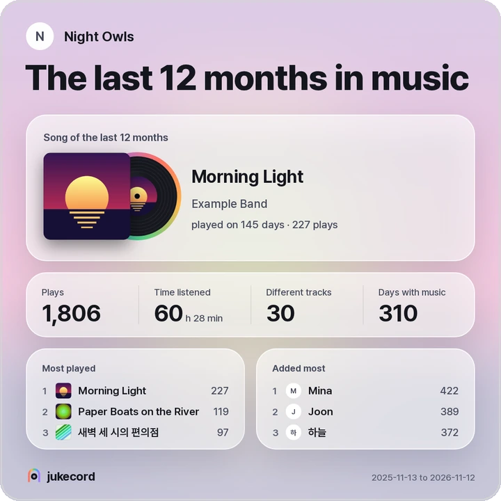

<p align="center">
  <picture>
    <source media="(prefers-color-scheme: dark)" srcset="docs/assets/logo-dark.svg">
    
  </picture>
</p>

<p align="center">
  <b>A self-hosted Discord music bot whose queue you also hear in the browser.</b><br>
  Friends in the voice channel and friends with only a browser tab hear the same song at the same second.
</p>

<p align="center">
  <a href="https://github.com/kanggu12/jukecord/actions/workflows/ci.yml"></a>
  <a href="https://github.com/kanggu12/jukecord/releases"></a>
  <a href="LICENSE"></a>
  
</p>

<p align="center">
  <a href="#quick-start">Quick start</a> &nbsp;|&nbsp;
  <a href="#how-it-works">How it works</a> &nbsp;|&nbsp;
  <a href="#features">Features</a> &nbsp;|&nbsp;
  <a href="#guides">Guides</a> &nbsp;|&nbsp;
  <a href="#contribute">Contribute</a>
</p>

<p align="center">
  <picture>
    <source media="(prefers-color-scheme: dark)" srcset="docs/assets/panel-dark.webp">
    
  </picture>
</p>

jukecord plays music from YouTube, SoundCloud and the other sites [yt-dlp](https://github.com/yt-dlp/yt-dlp) reads in
a Discord voice channel. Its web panel shows the same queue, and **Listen here** plays it in any browser at the same
place in the track: for a friend at work, on a phone, or without a Discord account. It runs on your own computer, a
Raspberry Pi or a Kubernetes cluster, and keeps everything there.

| Listen                                                                                                  | Host                                                                            | Contribute                                                                     |
| :------------------------------------------------------------------------------------------------------ | :------------------------------------------------------------------------------ | :----------------------------------------------------------------------------- |
| In Discord, or in a browser with a login or a friend's listening link. [Using jukecord](docs/README.md) | One command with Docker Compose, or the Helm chart. [Quick start](#quick-start) | The tests need no Discord bot and reach no site. [Where to start](#contribute) |

## How it works

<p align="center">
  <picture>
    <source media="(prefers-color-scheme: dark)" srcset="docs/assets/how-it-works-dark.svg">
    
  </picture>
</p>

Each Discord server has one queue and one player, and the player is the clock. The bot plays the voice channel from the
clock's place, and a browser that listens plays the same file in step with it. Discord, the panel, the API and the
command all call one list of actions, so the same rules hold whichever is used
([architecture](docs/ARCHITECTURE.md), [decisions](docs/DECISIONS.md)).

## Quick start

**Docker Compose** on Linux, macOS or Windows (WSL). It builds the image, starts jukecord and opens the panel:

```bash
git clone https://github.com/kanggu12/jukecord.git && cd jukecord
./jukecord up
./jukecord open
```

Without a bot token it plays in the browser only. [Make the bot](#the-discord-bot), then give it the token:

```bash
echo 'JUKECORD_DISCORD_TOKEN=YOUR_BOT_TOKEN' >> .env
./jukecord up
```

**Kubernetes** with the Helm chart, the token in a Secret of your own:

```bash
kubectl create namespace jukecord
kubectl -n jukecord create secret generic jukecord-discord --from-literal=token=YOUR_BOT_TOKEN
helm install jukecord oci://ghcr.io/kanggu12/charts/jukecord -n jukecord --set discord.existingSecret=jukecord-discord --wait
kubectl -n jukecord port-forward svc/jukecord 8795:8795 &
kubectl -n jukecord exec deploy/jukecord -- jukecord link
```

**From source**, with Node 24.11 or newer, ffmpeg and yt-dlp installed:

```bash
git clone https://github.com/kanggu12/jukecord.git && cd jukecord
npm ci && npm run build
JUKECORD_DISCORD_TOKEN=YOUR_BOT_TOKEN npm start
```

In another terminal, `node src/cli/main.ts link` prints a login link. [Installing](docs/INSTALL.md) covers a public
address for friends, logging in with Discord, updates and backups; [without internet](docs/OFFLINE.md), a machine that
cannot reach the registries.

### The Discord bot

1. On the [Discord Developer Portal](https://discord.com/developers/applications), make an application, open **Bot**
   and press **Reset Token**. That token is `JUKECORD_DISCORD_TOKEN`. No privileged intents are needed.
2. Open **OAuth2**, tick the scopes `bot` and `applications.commands` and the permissions **View Channels**, **Connect**
   and **Speak**, then open the link it makes to add the bot to your server.
3. For logging in with Discord, put the **Client ID** and **Client Secret** in `JUKECORD_DISCORD_CLIENT_ID` and
   `JUKECORD_DISCORD_CLIENT_SECRET`, and add `<your panel's address>/auth/callback` to **Redirects**. Without them only
   the host logs in, with `./jukecord open`.

The slash commands appear within seconds; `/play`, `/add`, `/np`, `/queue` and `/listen` are the everyday ones.

### What it runs on

|                    | Needs                                                                                                                                   |
| :----------------- | :-------------------------------------------------------------------------------------------------------------------------------------- |
| **Docker Compose** | Linux, macOS or Windows (WSL), amd64 or arm64, Docker with Compose 2.24 or newer; 430 MB for the image, 2 GiB for the cache             |
| **Raspberry Pi**   | A Pi 4 or 5 with a 64-bit system, through Docker Compose with a [released image](docs/INSTALL.md#raspberry-pi-and-other-arm64-machines) |
| **Kubernetes**     | The Helm chart on amd64 or arm64 nodes, k3s included, with a 5 GiB volume                                                               |
| **From source**    | Node 24.11 or newer, ffmpeg with libopus, and yt-dlp                                                                                    |
| **Listening**      | A current browser on a computer or a phone                                                                                              |

The first `./jukecord up` builds the image, FFmpeg included: about a minute on a fast desktop.

## Features

- **Listen along.** **Listen here** plays the queue in the browser in step with the voice channel, at its own volume;
  a browser more than 0.3 s off the clock jumps back in line. The media keys and the lock screen control it.
- **One queue, four ways in.** The panel, slash commands in English and Korean, the `jukecord` command and an HTTP API
  do the same things under the same rules ([the API](docs/API.md)).
- **Guests without Discord.** A listening link for 1, 7 or 30 days, with a QR code, lets anyone listen along to one
  server; revoking it ends its guests at once.
- **Logins and roles.** People log in with Discord and see the servers they share with the bot; a DJ role decides who
  may change the music.
- **Steady and small.** One process and one SQLite file, tracks fetched once and kept as Opus with their loudness
  evened out. It fetches only from public addresses and comes back where it was after a restart.

### Listen together

The words of the track playing follow the line being sung, for everyone ([LRCLIB](https://lrclib.net)). The light
behind the glass moves with the music while a browser listens. On a phone the panel installs like an app, and a sleep
timer stops listening after 15, 30 or 60 minutes or at the end of the track.

<p align="center">
  <picture>
    <source media="(prefers-color-scheme: dark)" srcset="docs/assets/phones-dark.webp">
    
  </picture>
</p>

### Find music, keep it

Search words show what YouTube found as you type, to play now, next or later. When the queue runs out, autoplay picks
from the server's own plays or from YouTube's mix of the last track. Likes, playlists as files (a list of addresses,
M3U or JSON), and links from Deezer, Spotify and Apple Music, found on YouTube.

### Fair in a crowd

Where a server has a DJ role, a skip from anyone else is a vote of the people listening. People can take turns, each
can be held to a number of tracks, and the bot can stay in voice all day. The voice channel has a volume up to 200 %
and sounds to choose (more bass, clearer voices, brighter, softer at night), which browsers listening along hear too.

### Wrapped

A server's year in music, a month or the last 12 months: the song of the year, the most played tracks, who added most
and the busiest hours, saved as a picture for a story or a post.

<p align="center">
  <picture>
    <source media="(prefers-color-scheme: dark)" srcset="docs/assets/wrapped-dark.webp">
    
  </picture>
</p>

### Looks after itself

A server nobody hears pauses after two minutes instead of fetching for nobody. After a restart the bot goes back to its
voice channel, an alerts channel hears about trouble (YouTube refusing jukecord, a disk nearly full, a failed backup),
and a backup can be made every day.

### Light on a small machine

On two processor cores with a year of use in it (a thousand tracks queued, 10,000 plays), jukecord rests at about
85 MiB of memory and answers each read of the panel in about 20 ms or less. A thousand panels open at once see each
change of the queue within about a tenth of a second ([how it was measured](docs/TESTING.md#measurements)).

## Everyday use

| To                   | With Docker Compose                                                       |
| :------------------- | :------------------------------------------------------------------------ |
| Open the panel       | `./jukecord open`                                                         |
| See how it runs      | `./jukecord status`, and `./jukecord doctor` to check every part          |
| Read the log         | `./jukecord logs`, or the **Log** page in the panel                       |
| Back up the database | `./jukecord backup`, into `./backups`; `JUKECORD_BACKUP_AT` for every day |
| Update               | `git pull && ./jukecord update`                                           |
| Stop                 | `./jukecord down`; the data stays                                         |

Anything else goes to the `jukecord` command inside: `./jukecord np`, `./jukecord add <address or words>`. On
Kubernetes it runs through `kubectl exec` ([Kubernetes](docs/KUBERNETES.md)).

## Your data

- Everything is in jukecord's data folder: one SQLite file, and the tracks it fetched with their pictures, up to
  `JUKECORD_CACHE_MAX`.
- Logins and tokens are kept as hashes, the logs mask tokens, and nothing is sent as telemetry.
- jukecord talks to Discord, to the sites the tracks come from, to LRCLIB for lyrics (`JUKECORD_LYRICS=off`) and to
  Deezer, Spotify or Apple Music for their links (`JUKECORD_LINK_SERVICES`). Browsers get covers from jukecord.
- Docker Compose opens the panel on this computer only, until you give it a
  [public address](docs/INSTALL.md#friends-on-other-machines).

## Guides

| Guide                                                                                              | What it covers                                                                            |
| :------------------------------------------------------------------------------------------------- | :---------------------------------------------------------------------------------------- |
| **Using it**                                                                                       |                                                                                           |
| [Using jukecord](docs/README.md)                                                                   | The panel, the slash commands, the `jukecord` command, who may do what, the settings      |
| [Questions and answers](docs/FAQ.md)                                                               | What it takes to run, listening with friends, what leaves your computer                   |
| [Troubleshooting](docs/TROUBLESHOOTING.md)                                                         | YouTube's bot check, a silent bot or browser, logins, a port in use                       |
| **Hosting it**                                                                                     |                                                                                           |
| [Installing](docs/INSTALL.md)                                                                      | Docker Compose, friends on other machines, logging in with Discord, Raspberry Pi, updates |
| [Kubernetes](docs/KUBERNETES.md)                                                                   | The Helm chart: its values, the Ingress, the NetworkPolicy, k3s                           |
| [Without internet](docs/OFFLINE.md)                                                                | Moving the image and the data to a machine without internet access                        |
| **Working on the code**                                                                            |                                                                                           |
| [The API](docs/API.md)                                                                             | Every operation over HTTP, beside its command and slash command, and the live updates     |
| [Architecture](docs/ARCHITECTURE.md) · [Decisions](docs/DECISIONS.md) · [Testing](docs/TESTING.md) | How it is built, why, and how it is checked                                               |

## Contribute

jukecord is MIT licensed and built in the open. Its tests need no Discord bot: yt-dlp and Discord have stand-ins, and
the panel is checked in a browser against a seeded server.

- **Report a bug or ask for a feature** in [Issues](https://github.com/kanggu12/jukecord/issues/new/choose).
- **Change the code.** [CONTRIBUTING.md](CONTRIBUTING.md) has the setup and a map of the code.
- **See what changed** in [CHANGELOG.md](CHANGELOG.md); report a security problem through
  [SECURITY.md](.github/SECURITY.md).

## License

[MIT](LICENSE). The image carries FFmpeg, yt-dlp and other parts under their own licences
([third-party notices](docs/THIRD_PARTY_NOTICES.md)).
