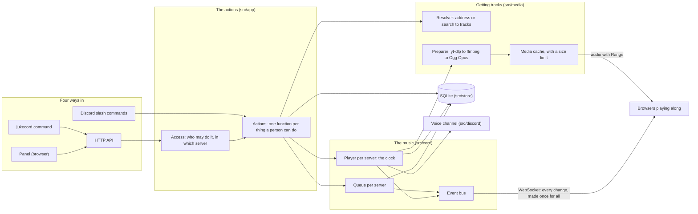

# How jukecord is built

One Node process, written in TypeScript and run as it is (Node strips the types; there is no build step for the
server, and the image carries the source with the types already stripped, line for line). Its parts, from the outside in:

## The actions are the product

`src/app/actions.ts` holds every action a person can take: add, play now, skip, seek, the queue edits, playlists,
voice, statistics, the DJ role. The panel, the slash commands, the API and the CLI only turn their input into a call
of one of these and show the answer. So a feature exists when it is an action, and the four ways in cannot drift apart:
the slash commands are a record over all action names (a missing one does not compile), the API is a table of
operations from which the server's routes, the OpenAPI document and the CLI's requests are all made, and a test checks
the four lists against each other.

## The player is the clock

Each server has one player (`src/core/player.ts`), a small state machine: idle, loading (fetching the track), playing,
paused. It decides where in the track everyone is. Every change ends in a snapshot: the status, the track, the place
(`positionMs`) at a server time (`at`), and a version number. The voice connection is told to start, pause or stop;
browsers get the snapshot over WebSocket and play the same file from the same place, correcting themselves when they
drift more than 300 ms. Each start of the outputs gets a session number, so an "ended" from a stream already replaced
(by a seek, or a skip) is recognised and ignored.

## Live updates for a crowd

Every panel showing a server gets the same messages, so each is made once for all of them (`src/web/events.ts`). The
queue goes out whole, at most four times a second: changes made close together are one message with the queue as it
ended, and the panel replaces its queue with each one. Who is listening goes out at most once a second, naming the
first twenty people. A big message is compressed once, as gzip, and the same bytes go to every panel whose browser can
unpack it; the WebSocket's own compression, which compressed every message again for each connection and kept a
compressor per connection, is off. A server's queue is serialised once per change, and a panel subscribing takes it
from there, adding only its own part (its voice channels). There are at most `JUKECORD_LIVE_MAX` connections (1000),
ten per login and twenty per address; one more is closed at once with 1013 and the reason, which the panel shows
before it tries again, later than after a drop.

## When it is busy

Changes are held to a rate per login and per address (token buckets: ten a second with twenty at once, and two a
second for the ones that start a fetch, like skip), and reads to a wider one (thirty a second with sixty at once, per
person, or per address without a login), answered with 429 and Retry-After beyond it. One process serves
every server, so while its event loop has fallen behind (the 99th percentile of its delay over the last second above
0.2 s) it turns away what can wait (audio for everyone, and changes from anyone but the host) with 503 and Retry-After
until it has caught up. The voice of every server and the panels' live updates are what it catches up on. Fetches somebody waits
for run at most twice the fetch limit at once (four on two cores): in a storm of skips the newest waits a moment for
a place, and the ones skipped while they waited never start.

## Getting a track

The resolver turns what was typed into tracks: an address seen before without asking the site, anything else through
yt-dlp (one request for a whole playlist). The preparer runs yt-dlp and ffmpeg together through a pipe: yt-dlp fetches
the best audio, ffmpeg evens the loudness (measured once per track and stored), adds a short fade in and out, and
writes Ogg Opus. That file is what Discord carries, so voice sends it as it is, and browsers get the same file (or an
MP3 copy made the first time a browser without Opus asks). A server that set a volume for its voice channel or a sound
gets that stream decoded, filtered and encoded again by ffmpeg, from the place the track is; browsers apply the same
sound themselves (`src/core/sound.ts` holds the sounds for both). The next tracks are prepared while one plays. Each
track's cover is fetched once too, by jukecord itself under the same address rule, and kept beside the audio; the panel
shows it from jukecord. The cache keeps the files up to its size limit, removing the least recently used first (a cover
by its own use) and never the one playing or the next ones.

yt-dlp reaches the internet only through a small proxy inside jukecord (`--proxy` to 127.0.0.1). The proxy resolves
each name itself, refuses addresses on private networks, and connects to the very address it checked, so a redirect, a
playlist entry or a name that answers differently the second time cannot make the server fetch from its own network.
An address someone types is also checked before yt-dlp starts, which gives the clearer message.

## Looking after itself

A few watches run beside the music, each in a file of its own. `src/app/rest.ts` pauses a playing server nobody hears
anywhere (the bot out of its voice channel, no browser playing along) after two minutes, from the bus's player, voice
and listener events. `src/discord/rejoin.ts` keeps the voice channel each server's bot is in, from the bus's voice
events, and goes back to it after a restart when people are there. `src/discord/keeper.ts` edits the newest
now-playing card of each server as its player changes, at most every five seconds. `src/app/alerts.ts` tells the
alerts channel a server chose (and the log) about trouble, each kind at most once an hour: YouTube's check for bots
(from how fetches and lookups go), a restart by the watchdog (it leaves a mark the next start reads), a disk nearly
full, a track taken out of a looping queue, connections turned away at a cap, a scheduled backup that failed.
`src/app/backups.ts` makes the backups, the daily one too.

## Storage

One SQLite file (Node's built-in driver, no native add-on, so the same image runs on amd64 and arm64), with numbered
migrations and WAL. It holds tracks, queues, history (the newest 10,000 plays per server), playlists, each player's
state (so a restart comes back paused at the same place), settings, the people jukecord has met (for names in the
panel), panel logins and API tokens (both as SHA-256 hashes). Backups use `VACUUM INTO`, a consistent copy while
jukecord runs.

## Logging in

The host (the machine running jukecord) has a token in the data directory, readable by jukecord's user only; its
command line uses it, and it can make one-time login links for a browser. Other people log in with Discord (OAuth2,
the `identify` scope only); whether they are in a server, and with which roles, is asked through the bot and kept for a
minute. Programs use API tokens with a scope. A panel session changes nothing without its CSRF token in a header.

## Files

| Path            | What is there                                                   |
| :-------------- | :-------------------------------------------------------------- |
| `src/main.ts`   | starts the parts in order and stops them in order               |
| `src/config.ts` | the settings, every problem reported at once                    |
| `src/app/`      | the actions, who may do what, the self-check, the watches above |
| `src/core/`     | queue, player, clock, event bus                                 |
| `src/media/`    | yt-dlp, ffmpeg, the cache, preparing and prefetching            |
| `src/discord/`  | the bot, slash commands, cards, voice                           |
| `src/web/`      | the API table, routes, logins, live updates, OpenAPI            |
| `src/cli/`      | the `jukecord` command                                          |
| `src/store/`    | the database and its migrations                                 |
| `panel/`        | the browser app (TypeScript, bundled with esbuild)              |
| `deploy/`       | the Dockerfile, the Helm chart, the kind test, the systemd unit |
| `tests/`        | unit, integration, packaging and UI tests                       |
